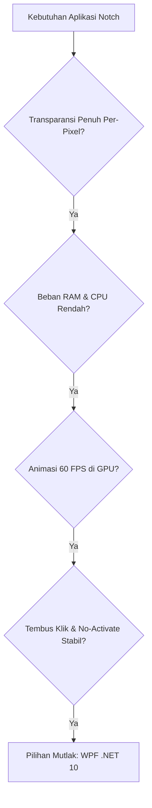
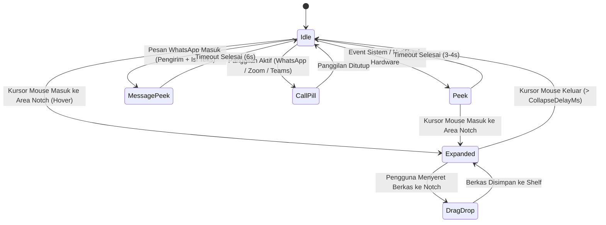

# Dokumentasi Lengkap & PRD Pengembangan SmartNotch

> **SmartNotch** adalah aplikasi utilitas desktop untuk Windows yang mengadaptasi pengalaman interaktif **MacBook Notch & iOS Dynamic Island** (terinspirasi dari konsep aplikasi **Nusa** oleh `@citoxstd`). Aplikasi ini berjalan melayang di bagian atas layar monitor, menyatu secara mulus dengan bezel, dan merespons berbagai event sistem maupun input pengguna secara real-time.

---

## 1. Ringkasan Proyek & Filosofi Desain

Windows secara umum tidak memiliki notch fisik bawaan pada monitor laptop maupun desktop. SmartNotch merekayasa ilusi notch fisik tersebut melalui teknik *per-pixel alpha composition* pada window WPF borderless.

### Prinsip Utama:
- **1:1 Nusa Design Aesthetic**: Tampilan minimalis, tanpa tab bar kaku di bagian bawah, menggunakan aksen sudut melengkung halus, efek pendaran ambien (*ambient glow*) dari sampul album, dan navigasi geser alami.
- **Ringan & Non-Intrusif**: Tidak mencuri fokus dari aplikasi yang sedang aktif bekerja (*no activate*), tembus klik saat area kosong di-klik (*click-through*), dan otomatis sembunyi saat pengguna membuka aplikasi atau game layar penuh (*fullscreen*).
- **Responsif & Hardware-Aware**: Menangkap event baterai, charging, Bluetooth (AirPods/TWS), Flashdisk/USB, Type-C, panggilan telepon, hingga pesan masuk WhatsApp secara instan.

---

## 2. Teknologi yang Digunakan (*Tech Stack*) & Alasan Pemilihannya

Aplikasi ini dibangun menggunakan tumpukan teknologi modern berkinerja tinggi yang dipilih secara cermat melalui pertimbangan arsitektur dan efisiensi sistem:

| Lapisan / Komponen | Teknologi | Keterangan & Peran Utama |
|---|---|---|
| **Bahasa Pemrograman** | **C# 13** | Bahasa bertipe kuat, modern, aman memori, dan native pada platform Windows. |
| **Runtime & SDK** | **.NET 10 (`net10.0-windows10.0.19041.0`)** | SDK Windows Desktop modern dengan akses ganda ke Win32 API dan Windows Runtime (WinRT). |
| **UI Framework** | **WPF (Windows Presentation Foundation)** | Rendering akselerasi hardware DirectX, transparansi per-pixel, dan kurva animasi vektor XAML. |
| **Integrasi Media (Now Playing)** | **WinRT SMTC (`Windows.Media.Control`)** | Menangkap data lagu aktif, artwork, durasi, dan kontrol playback dari semua aplikasi pemutar di Windows. |
| **Penyedia Lirik Musik** | **LRCLIB REST API (`HttpClient`)** | Database lirik terbuka untuk mengambil lirik sinkron (*timestamped LRC*) otomatis tanpa API key. |
| **Pembaca Notifikasi & Pesan** | **SQLite (`Microsoft.Data.Sqlite`)** | Membaca database notifikasi lokal (`wpndatabase.db`) secara non-intrusif sehingga pesan WhatsApp terbaca tanpa batasan paket MSIX. |
| **Deteksi Panggilan Multi-App** | **Win32 Registry & WASAPI Capture** | Memantau sesi penggunaan mikrofon kernel untuk WhatsApp, Zoom, Teams, Discord, dan Skype. |
| **Konektivitas Nirkabel** | **WinRT Bluetooth & Audio Endpoint** | Memantau koneksi AirPods/TWS/Headphone/Gamepad secara real-time via `DeviceWatcher` & `MediaDevice`. |
| **Deteksi Perangkat Keras USB** | **Win32 Messages (`WM_DEVICECHANGE`)** | Menangkap event kernel tancap/cabut perangkat USB, kabel Type-C, dan partisi volume Flashdisk. |
| **Manajemen Daya Baterai** | **Win32 `GetSystemPowerStatus`** | Membaca persentase baterai presisi dan status charging AC tanpa overhead WMI. |
| **Manipulasi Window Tingkat Rendah** | **Win32 User32 & Shell32** | Mengatur gaya jendela melayang (`WS_EX_TOOLWINDOW`, `WS_EX_NOACTIVATE`, `WS_EX_TRANSPARENT`), penempatan monitor fisik (`SetWindowPos`), hotkey global, dan sensor layar penuh. |
| **Pengujian Otomatis (Testing)** | **xUnit & .NET Test SDK** | Test suite otomatis 25 test cases mencakup settings serialization, normalisasi, water tracking, dan log rotation. |
| **Pengemasan & Distribusi** | **Inno Setup 6 (ISCC)** | Memaketkan aplikasi menjadi installer instalasi mandiri (*self-contained setup .exe*) bebas dependensi. |

---

### 2.1. Mengapa Memilih C# dan .NET 10? (Bukan Python, Node.js, C++, atau Rust)

1. **Jembatan Dua Dunia: Win32 API + Windows Runtime (WinRT)**:
   - Aplikasi notch desktop membutuhkan komunikasi langsung ke kernel Windows (seperti mendeteksi window fullscreen, manipulasi gaya jendela transparan, dan broadcast USB).
   - Di sisi lain, aplikasi ini juga membutuhkan API Windows 10/11 modern (seperti WinRT SMTC untuk Spotify dan WinRT Bluetooth Watcher).
   - C# melalui SDK `net10.0-windows10.0.19041.0` adalah **satu-satunya bahasa yang mendukung kedua ekosistem ini secara native tanpa jembatan (*bridge*) tambahan**.
2. **Efisiensi Memori & Kecepatan JIT Modern**:
   - Jika menggunakan Python atau Node.js, aplikasi widget sederhana ini akan memakan 150–300 MB RAM dan lambat saat merespons event hover mouse.
   - Dengan .NET 10, kompilasi JIT (*Just-In-Time*) dan garbage collector generasi terbaru membuat SmartNotch hanya mengonsumsi **~30–45 MB RAM saat idle** dengan beban CPU **0.0%**.
3. **Keseimbangan Keamanan Memori (*Memory Safety*) vs Kinerja**:
   - Dibandingkan C++ murni yang rawan *memory leak*, *pointer dangling*, dan memakan waktu pengembangan sangat lama, C# memberikan keamanan memori penuh dengan kecepatan eksekusi yang hampir setara.

---

### 2.2. Mengapa Memilih WPF? (Bukan Electron, Tauri, WinUI 3, Flutter, atau WinForms)

Pemilihan UI framework adalah keputusan paling krusial dalam pembuatan SmartNotch:



#### Perbandingan Komparatif Antar Framework UI:

| Framework | Konsumsi RAM | Transparansi Per-Pixel | Tembus Klik (*Click-Through*) | Dukungan DirectX GPU | Kesimpulan |
|---|---|---|---|---|---|
| **Electron** (JS/HTML) | 250 MB – 500 MB | Sering glitch di multi-monitor | Sangat sulit & rawan bug | Ya (Chromium) | **Ditolak**: Terlalu berat dan boros baterai untuk widget yang hidup 24/7 di layar. |
| **WinUI 3 / App SDK** | 90 MB – 140 MB | Belum stabil (ada border putih) | Terbatas | Ya (DirectX 12) | **Ditolak**: Bug kompositor jendela transparan frameless belum teratasi di Windows 10/11. |
| **Windows Forms** | 25 MB – 40 MB | Tidak mendukung (GDI kaku) | Terbatas | Tidak (GDI Software) | **Ditolak**: Tidak mampu merender kurva bezier, drop shadow halus, atau animasi 60 FPS. |
| **Tauri / Flutter** | 60 MB – 120 MB | Memerlukan trik webview | Sulit dikontrol via Win32 | Ya | **Ditolak**: Tidak memiliki integrasi native langsung ke Windows SMTC dan broadcast hardware kernel. |
| **WPF (C# .NET)** | **30 MB – 45 MB** | **Sempurna (`AllowsTransparency`)** | **Sempurna (`WS_EX_TRANSPARENT`)** | **Ya (DirectComposition)** | **Dipilih**: Stabil, matang, performa tinggi, dan akselerasi GPU murni. |

**Keunggulan Utama WPF untuk Notch:**
- **Akselerasi GPU Hardware-Rendered**: Seluruh bentuk notch vektor (`Path`), sudut membulat, bayangan drop shadow, pendaran ambien (*ambient glow*), dan gelombang musik equalizer di-render langsung oleh kartu grafis via DirectComposition, bukan CPU software rendering.
- **WPF Animation Clock**: Animasi kurva (`SineEase`, `CubicEase`) dieksekusi secara native pada frekuensi refresh monitor (60 Hz / 120 Hz / 144 Hz) tanpa terpengaruh oleh event loop aplikasi lain.

---

### 2.3. Mengapa Memilih WinRT SMTC untuk Musik? (Bukan Spotify Web API)

1. **Bekerja untuk SEMUA Aplikasi Pemutar Media di Windows**:
   - Jika kita menggunakan Spotify Web API, notch HANYA bisa membaca Spotify.
   - Dengan **WinRT SMTC (`GlobalSystemMediaTransportControlsSessionManager`)**, notch secara otomatis membaca:
     - Spotify Desktop
     - Apple Music Desktop
     - YouTube, YouTube Music, SoundCloud di Google Chrome, Microsoft Edge, Firefox, Brave
     - Media player offline seperti VLC, Windows Media Player, foobar2000, AIMP
2. **Nol Konfigurasi & Privasi Terjaga**:
   - Tidak memerlukan akun Spotify Developer, tidak membutuhkan client secret, dan pengguna tidak perlu login/OAuth.
   - Mengambil data langsung dari session bus Windows secara lokal dengan latensi 0 milidetik.
3. **Komunikasi Dua Arah**:
   - Selain membaca judul, artis, durasi, dan cover art, notch juga bisa langsung mengirimkan perintah *Play, Pause, Next, Previous* langsung ke pemutar yang sedang aktif.

---

### 2.4. Mengapa Memilih LRCLIB untuk Lirik Musik?

1. **Sepenuhnya Terbuka & Bebas Biaya**:
   - Berbeda dengan Musixmatch atau Genius yang membatasi panggilan API komersial dan mewajibkan token berbayar, LRCLIB menyediakan akses REST API gratis untuk komunitas pengembang.
2. **Format Lirik Sinkron Bertanda Waktu (*Timestamped LRC*)**:
   - Menyediakan data lirik baris-demi-baris dengan cap waktu milidetik presisi (`[01:23.45] Baris lirik`).
3. **Pencarian Cerdas Toleran Judul**:
   - Otomatis membersihkan variasi judul lagu (misalnya menghapus *"(Remastered 2021)"* atau *"(feat. Artist)"*) agar probabilitas lirik ditemukan maksimal.

---

### 2.5. Mengapa Menggunakan Core Audio API (WASAPI) untuk Volume & Panggilan?

1. **Akses Langsung ke Master Endpoint Kernel Audio**:
   - Berbeda dari API warisan `waveOutSetVolume` yang hanya mengatur volume aplikasi itu sendiri, **Core Audio API (`IMMDeviceEnumerator` & `IAudioEndpointVolume`)** mengatur langsung *Master Hardware Volume* Windows.
2. **Kendali Skalar Presisi (0.0 – 1.0)**:
   - `SetMasterVolumeLevelScalar` mengontrol volume secara linear sesuai persepsi pendengaran manusia (*perceptual loudness curve*).
3. **Pembedaan Perubahan Volume Internal vs Eksternal**:
   - Saat pengguna menggeser slider di dalam widget notch, notch tidak menampilkan pop-up HUD Peek yang menumpuk.
   - Namun, saat volume diubah melalui tombol keyboard fisik (Fn+F2/F3) atau tombol knob eksternal, SmartNotch mendeteksi perubahan dari luar dan menampilkan banner HUD Peek elegan selama 1.8 detik (`🔊 Volume 45%` atau `🔇 Audio Dibisukan`).

---

## 3. Arsitektur Sistem & State Machine

SmartNotch bekerja berdasarkan mesin status (*state machine*) dinamis yang mendukung multi-state:



### Dimensi & Karakteristik Setiap State:

| State | Ukuran (px) | Sudut Lengkung (*CornerRadius*) | Konten & Perilaku |
|---|---|---|---|
| **Idle** | `200 x 32` | Bawah: `14px` | Standby minimalis: Cincin baterai melingkar, jam digital / countdown timer, dan 3-bar equalizer gelombang harmonik. |
| **Call Pill (Idle Call)** | `240 x 32` | Bawah: `14px` | Kapsul Dynamic Island saat telepon aktif: Badge telepon hijau `📞`, nama kontak, durasi timer, dan gelombang suara hijau. |
| **Peek (Standard)** | `340 x 40` | Bawah: `18px` | Banner status 1-baris pop-up sementara (3–4 detik) untuk event hardware (Bluetooth, USB, charger, volume). |
| **Message Peek** | `400 x 70` | Bawah: `18px` | Banner preview pesan 2-baris (6 detik): Baris 1 nama kontak WhatsApp, baris 2 isi teks pesan lengkap. |
| **Expanded** | `640 x 190` | Bawah: `24px` | Panel kendali penuh yang meluncur ke bawah saat mouse menyentuh notch, berisi 7 widget interaktif modular. |

---

## 4. Rincian Desain & Fitur Lengkap

### 4.1. Tampilan Idle (1:1 Nusa)
1. **Cincin Baterai Melingkar (*Circular Battery Ring*) di Kiri**:
   - Dibuat secara matematis menggunakan `PathGeometry` dan `ArcSegment` di dalam `Canvas` 16x16 px konsentris.
   - Cincin hijau (`#30D158`) mengisi melingkar searah jarum jam sesuai sisa persentase baterai laptop Anda.
   - Menampilkan ikon petir kecil **`⚡`** di tengah lingkaran saat laptop tersambung charger.
   - Otomatis berubah warna merah (`#FF453A`) jika baterai berada di bawah 20%.
2. **Jam Digital Murni di Tengah**:
   - Menampilkan jam dan menit digital bersih (`HH:mm`), atau countdown waktu saat timer fokus Pomodoro berjalan.
3. **Gelombang Equalizer Musik 3-Batang di Kanan**:
   - Terdiri dari 3 batang rounded pill (`lebar 2.8px`, `radius 1.4px`, putih bersih `#F5FFFFFF`).
   - Menggunakan kurva perlambatan gelombang sinus murni (**`SineEase EaseInOut`**) dengan tempo tersinkronisasi 0.72 detik.
   - Menghasilkan gerakan gelombang audio yang sangat lentur, anggun, dan tidak acak.
   - Berubah menjadi titik/cincin merah minimalis saat standby atau saat timer fokus aktif.

---

### 4.2. Panel Widget Interaktif (Expanded State)

Notch memiliki 7 widget modular yang dapat digeser secara horizontal:

1. **Widget Musik & Lirik Sinkron (`MediaWidget.cs`)**:
   - **Cover Album 56x56 px** dengan lengkungan sudut 14 px.
   - **Aksen Pendaran Ambien (*Ambient Glow*)**: Gradasi warna di bagian bawah notch secara dinamis mengekstrak warna dominan dari sampul lagu yang sedang berputar di Spotify/browser.
   - **Timeline Slider**: Garis penunjuk durasi lagu dengan tombol bundar (*circular thumb knob*).
   - **Lirik 3-Baris Vertikal Sinkron**: Menampilkan baris sebelum, baris aktif (teks tebal putih), dan baris berikutnya secara otomatis sesuai detik lagu berjalan via LRCLIB.
   - **Slider Volume Interaktif**: Track volume master dengan knob bulat, mute toggle, dan scroll roda mouse.
   - **Kontrol Lengkap**: Tombol toggle lirik `💬`, Sebelumnya `⏮`, Putar/Jeda `▶`/`⏸`, dan Berikutnya `⏭`.
2. **Widget Kartu Panggilan (`CallWidget.cs`)**:
   - Avatar kontak beranimasi halo pulse hijau, nama kontak tebal, status panggilan, timer durasi real-time, visualisasi 4-batang gelombang suara, tombol **💬 Buka Aplikasi**, dan tombol **🎙 / 🔇 Mute Mic**.
3. **Widget Pesan & Notifikasi (`NotifWidget.cs`)**:
   - Menampilkan daftar pesan masuk WhatsApp dan notifikasi sistem dengan badge hijau `💬 WhatsApp`, waktu pesan, nama pengirim, teks isi pesan lengkap, tombol **Bersihkan**, serta **kemampuan klik langsung (`↗`)**: Setiap kartu notifikasi dapat diklik untuk langsung membuka atau memfokuskan aplikasi pengirim ke layar depan melalui `AppLauncherService`.
4. **Widget File Shelf (`ShelfWidget.cs`)**:
   - Area kotak putus-putus (*dashed border*) bertuliskan `📥 Lepaskan file di sini`.
   - Cukup seret (*drag and drop*) file apa pun ke notch untuk disimpan sementara, melihat daftar kartu berkas, dan menyeretnya kembali ke aplikasi lain.
5. **Widget Timer Fokus (`TimerWidget.cs`)**:
   - Pengatur waktu produktivitas Pomodoro dengan tombol preset cepat (5, 15, 25, 50 mnt), durasi kustom, notifikasi suara saat selesai, dan hitungan mundur di jam idle notch.
6. **Widget Pengingat Minum Air (`WaterWidget.cs`)**:
   - Pengingat teratur menjaga hidrasi tubuh dengan tombol pencatat asupan (+250ml, +500ml), progress bar persentase target harian, dan rollover reset otomatis saat berganti hari.
7. **Widget Pemantau Sistem (`SystemWidget.cs`)**:
   - Grafik performa real-time untuk beban prosesor CPU, penggunaan RAM, dan kecepatan upload/download jaringan internet.

---

### 4.3. Navigasi & Animasi Transisi Halus
- **Transisi Horizontal Slide & Fade**:
  Saat berpindah antar tab (via tombol `‹` / `›`, scroll roda mouse, atau titik paginasi):
  - Halaman lama meluncur keluar sejauh `55px` sambil memudar (*fade out* 180ms).
  - Halaman baru meluncur masuk dari sisi berlawanan (`55px` ke `0`) sambil muncul jelas (*fade in* 260ms).
  - Menggunakan kurva gerak **`CubicEase EaseOut`** dengan penyekatan `ClipToBounds="True"` agar konten tidak tembus ke luar batas notch.
  - Dilengkapi mekanisme pencegah *race condition* agar transisi cepat (mis. saat roda mouse di-scroll cepat) tidak menyebabkan panel kosong (*blank panel protection*).
- **Indikator Titik Paginasi**:
  Titik paginasi di bawah notch (`• • ━ • •`) memanjang lembut menjadi bentuk kapsul putih (*pill*) sesuai widget yang aktif.

---

### 4.4. Deteksi Hardware & Integrasi Panggilan Multi-App

1. **Deteksi Panggilan Multi-Aplikasi (`CallAppMatcher.cs` & `WhatsAppCallService.cs`)**:
   - Memantau penggunaan mikrofon kernel via Registry `HKCU\Software\Microsoft\Windows\CurrentVersion\CapabilityAccessManager\ConsentStore\microphone` dan WASAPI audio session.
   - Mendukung aplikasi komunikasi populer secara otomatis: **WhatsApp, Zoom, Microsoft Teams, Discord, dan Skype** (daftar aplikasi dapat dikustomisasi di Pengaturan).
   - Menampilkan Dynamic Island Call Pill saat panggilan berlangsung dan Call Card saat notch dibuka.
2. **Pembaca Notifikasi Toast Windows (`WpnNotificationReader.cs`)**:
   - Membaca salinan file database notifikasi Windows `%LOCALAPPDATA%\Microsoft\Windows\Notifications\wpndatabase.db` menggunakan SQLite.
   - Mengatasi batasan sistem operasi Windows di mana aplikasi `.exe` mandiri non-packaged dilarang memakai `UserNotificationListener`.
   - Mengambil XML toast notification untuk mengekstrak nama kontak dan isi pesan WhatsApp secara instan.
3. **Koneksi Bluetooth (`BluetoothService.cs`)**:
   - Memantau perangkat Bluetooth melalui `DeviceWatcher` dan pergantian audio endpoint `MediaDevice`.
   - Menampilkan notifikasi banner saat TWS/AirPods/speaker/gamepad terhubung atau terputus.
4. **USB, Type-C, & Flashdisk (`UsbDeviceService.cs`)**:
   - Menangkap pesan kernel `WM_DEVICECHANGE` untuk mendeteksi tancap/cabut Flashdisk (membaca huruf drive dan volume label), HP, atau periferal USB.
5. **Kabel Charger / Pengisi Daya**:
   - Membaca status AC Line secara instan dan menampilkan persentase baterai real-time saat charger dicolok atau dicabut.
6. **Peluncur & Pemfokus Aplikasi Notifikasi (`AppLauncherService.cs`)**:
   - Menangani pengalihan fokus saat pengguna mengklik banner notifikasi Peek atau kartu notifikasi di widget "Pesan":
     - **Pencarian Jendela Terbuka**: Memeriksa `MainWindowHandle` dan seluruh top-level windows (`EnumWindows`) yang cocok dengan nama proses atau judul jendela (mis. WhatsApp, Telegram, Discord, Teams, Spotify, Skype, Zoom, Slack, dll.).
     - **Restorasi Jendela & Foreground Bypass**: Memulihkan jendela yang terminimalkan (`SW_RESTORE`), membawa ke posisi paling atas (`BringWindowToTop`), dan mengeksekusi simulasi event tombol Alt (`VK_MENU`) agar sistem operasi Windows mengizinkan perpindahan status proses foreground tanpa diblokir.
     - **Fallback Peluncuran**: Jika jendela belum aktif atau aplikasi berjalan di latar belakang, memicu URL Protocol Scheme (`whatsapp:`, `tg:`, `discord:`, dll.) atau menjalankan AUMID Windows Store Package via `shell:AppsFolder\<AUMID>`.
     - **Smart Peek Hover**: Timer auto-close banner notifikasi otomatis dijeda saat kursor berada di atas notch agar pengguna leluasa membaca dan mengklik. Menahan kursor > 1.2 detik otomatis memperluas notch ke tab "Pesan".

---

### 4.5. Jendela Pengaturan & Multi-Monitor (`SettingsWindow.cs` & `SettingsService.cs`)

- **Penyimpanan Konfigurasi**: Preferensi pengguna disimpan rapi dalam format JSON di `%LOCALAPPDATA%\SmartNotch\settings.json`.
- **Fitur Pengaturan**:
  - Pilihan aktif/tidaknya tiap widget di panel expanded.
  - Kustomisasi durasi Pomodoro dan suara notifikasi alarm.
  - Interval pengingat minum dan target volume harian.
  - Pilihan monitor aktif: Menempatkan notch di monitor pilihan (monitor utama atau monitor eksternal 1, 2, dst) dengan koordinat piksel fisik DPI-aware (`SetWindowPos`).
  - Hotkey global kustom (default: `Ctrl + Alt + N`).
  - Pengatur jeda menutup (*collapse delay*) saat kursor meninggalkan notch.
  - Pengatur **Opasitas Notch (70% - 100%)** untuk penyesuaian transparansi gelap elegan.
  - Toggle **Suara Bel Notifikasi** (chime lembut) saat ada pesan WhatsApp/notifikasi baru.
  - Sensor layar penuh (*fullscreen suppression*): Otomatis menyembunyikan notch jika aplikasi/game fullscreen sedang aktif di monitor tersebut.
  - Pengatur autostart bersama Windows (tersinkronisasi penuh dengan registry dan tray).
- **Pengoptimal Memori Otomatis (`MemoryOptimizer.cs`)**:
  - Memanggil `EmptyWorkingSet` via `psapi.dll` pasca-startup dan setiap kali notch menutup (*collapse*) dari mode Expanded ke Idle, memastikan footprint RAM tetap sangat rendah (~35-45 MB).

---

### 4.6. Sistem Logging & Pengujian Otomatis

- **Logging Otomatis (`Log.cs`)**:
  - Log aktivitas dan error tersimpan di `%LOCALAPPDATA%\SmartNotch\logs\smartnotch-YYYYMMDD.log`.
  - Rotasi log otomatis membersihkan berkas yang lebih lama dari 7 hari.
  - Dilengkapi deduplikasi pesan log berulang untuk menjaga ukuran berkas tetap ringkas.
- **Unit Test Suite (`tests/SmartNotch.Tests`)**:
  - Dilengkapi 32 kasus pengujian otomatis berbasis xUnit:
    - Pengujian serialisasi dan deserialisasi `SettingsService`.
    - Pengujian normalisasi nilai di luar rentang dan fallback default.
    - Pengujian logika akumulasi dan rollover harian `WaterTracker`.
    - Pengujian pencocokan aplikasi panggilan `CallAppMatcher`.
    - Pengujian parsing versi dan komparator `UpdateService`.
    - Pengujian penulisan berkas dan pengecualian `Log`.
    - Pengujian kandidat proses, skema URI, dan penyimpanan `PrimaryId` notifikasi `AppLauncherService`.

---

## 5. Struktur Direktori Kode Sumber

```
smartnotch/
├── build-installer.ps1                # Skrip otomatisasi build & compile installer
├── DOKUMENTASI_SMARTNOTCH.md          # Dokumen PRD dan arsitektur teknis lengkap proyek
├── README.md                          # Panduan pengenalan, fitur, dan unduhan
├── dist/                              # Direktori output hasil build
│   ├── publish/                       # File aplikasi mandiri portable (SmartNotch.exe)
│   └── SmartNotch-Setup-1.1.0.exe     # Installer setup Windows resmi
├── installer/
│   ├── SmartNotch.iss                 # Naskah kompilasi Inno Setup Compiler v1.1.0
│   └── assets/                        # Ikon aplikasi & gambar wizard installer
├── src/
│   └── SmartNotch.App/
│       ├── App.xaml / App.xaml.cs     # Konfigurasi aplikasi, startup, tray menu & global error handlers
│       ├── app.manifest               # Konfigurasi sadar DPI (PerMonitorV2) & izin sistem
│       ├── SettingsWindow.cs          # UI Jendela Pengaturan preferensi pengguna
│       ├── SmartNotch.App.csproj      # File proyek .NET 10 WPF, SQLite & WinRT SDK
│       ├── NotchWindow.xaml           # Definisi tata letak XAML (Idle, Call Pill, Peek, Expanded)
│       ├── NotchWindow.xaml.cs        # State machine, animasi transisi, DPI math, event loop & Win32 hook
│       ├── Interop/
│       │   └── Win32.cs               # Definisi P/Invoke Win32 API (User32, Kernel32, Shell32, SetWindowPos)
│       ├── Services/
│       │   ├── SettingsService.cs     # Layanan penyimpanan & normalisasi konfigurasi JSON
│       │   ├── Log.cs                 # Layanan file logger thread-safe dengan rotasi 7 hari
│       │   ├── WpnNotificationReader.cs # Pembaca database notifikasi Windows (SQLite)
│       │   ├── CallAppMatcher.cs      # Logika pencocokan aplikasi panggilan (WhatsApp/Zoom/Teams/dll)
│       │   ├── WhatsAppCallService.cs # Layanan pendeteksi & pengendali panggilan komunikasi
│       │   ├── UpdateService.cs       # Pengecek rilis pembaruan GitHub Releases
│       │   ├── WaterTracker.cs        # Logika pelacak asupan air harian & rollover
│       │   ├── AudioVolumeService.cs  # Layanan kontrol Master Hardware Volume via Core Audio API
│       │   ├── BluetoothService.cs    # Pemantau koneksi Bluetooth & audio endpoint
│       │   ├── UsbDeviceService.cs    # Pemantau hardware USB, Type-C, dan Flashdisk
│       │   ├── MediaService.cs        # Integrasi WinRT SMTC pemutar musik & ekstraksi warna ambien
│       │   ├── LyricsService.cs       # Klien pengambil lirik sinkron LRCLIB
│       │   ├── SystemServices.cs      # Layanan baterai, CPU, RAM, internet, Pomodoro & Minum
│       │   └── NotifCalendarServices.cs # Layanan notifikasi Windows & agenda kalender
│       └── Widgets/
│           ├── CallWidget.cs          # UI Kartu Panggilan Komunikasi (1:1 Apple Call Card)
│           ├── NotifWidget.cs         # UI Kartu Riwayat Pesan WhatsApp & Notifikasi
│           ├── MediaWidget.cs         # UI Pemutar Musik, Lirik 3-Baris & Slider Volume
│           ├── ShelfWidget.cs         # UI Drag & Drop File Shelf
│           ├── TimerWidget.cs         # UI Timer Fokus Pomodoro
│           ├── WaterWidget.cs         # UI Pengingat Minum Air
│           ├── SystemWidget.cs        # UI Grafik Mini Pemantau Sistem
│           └── Ui.cs                  # Pustaka pembantu pembuatan komponen UI dinamis
└── tests/
    └── SmartNotch.Tests/
        ├── SmartNotch.Tests.csproj    # Proyek pengujian otomatis berbasis xUnit
        └── CoreTests.cs               # 25 automated test cases (Settings, Water, Call, Update, Log)
```

---

## 6. Panduan Menjalankan, Menguji & Membangun Proyek

### Kebutuhan Sistem:
- Windows 10 (Versi 2004 / Build 19041 ke atas) atau Windows 11.
- .NET 10 SDK (terpasang di `C:\Program Files\dotnet\dotnet.exe`).
- Inno Setup 6 (terpasang via `winget install JRSoftware.InnoSetup`).

### 1. Menjalankan Langsung (*Development Mode*):
Jalankan perintah berikut di PowerShell dari folder proyek:
```powershell
dotnet run --project src/SmartNotch.App/SmartNotch.App.csproj
```

### 2. Menjalankan Pengujian Otomatis (*Unit Tests*):
Jalankan test suite untuk memvalidasi fungsionalitas logika:
```powershell
dotnet test tests/SmartNotch.Tests
```

### 3. Membangun Installer Setup Resmi (*Production Distribution*):
Cukup jalankan satu skrip otomatis berikut dari PowerShell:
```powershell
.\build-installer.ps1
```
Skrip ini akan secara otomatis:
1. Mem-publish aplikasi dalam mode *self-contained win-x64* ke folder `dist/publish/`.
2. Menjalankan Inno Setup Compiler (`ISCC.exe`) untuk mengemasnya menjadi installer setup di `dist/SmartNotch-Setup-1.1.0.exe`.

---

## 7. Pintasan & Interaksi Pengguna

- **Buka / Tutup Notch Manual**: Arahkan kursor mouse ke bagian atas tengah layar, atau tekan pintasan keyboard global **`Ctrl + Alt + N`** (dapat diubah di Pengaturan).
- **Buka Menu Pengaturan**: Klik kanan pada ikon SmartNotch di system tray pojok kanan bawah Windows → pilih **Pengaturan...**.
- **Pindah Antar Fitur / Halaman**:
  - Klik tombol panah samping **`‹`** (kiri) atau **`›`** (kanan).
  - Scroll roda mouse ke atas / ke bawah saat kursor berada di atas notch.
  - Klik langsung salah satu titik indikator paginasi di bawah notch.
- **Simpan File Cepat**: Seret berkas apa saja dari File Explorer ke notch; notch akan otomatis beralih ke tab **Shelf** dan menyimpan berkas tersebut.
- **Fokus ke WhatsApp saat Telepon**: Klik pada kapsul telepon (*Call Pill*) di notch idle saat panggilan berlangsung untuk langsung membawa jendela WhatsApp ke layar depan.
